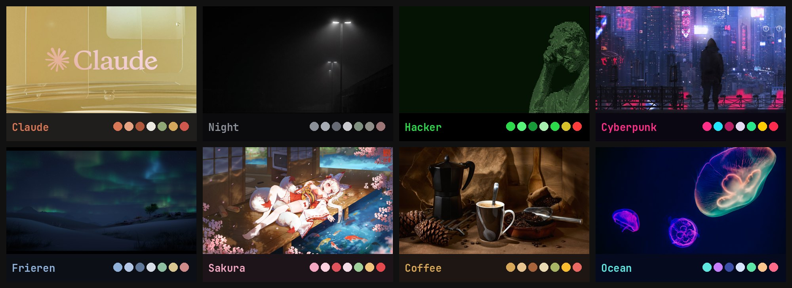

# hypr-rice

[Русский](README.md) · **English**

A ready desktop for Arch Linux: Hyprland 0.57+ (Lua config), menus and windows in Quickshell, a Waybar
bar. Nine themes. A theme changes everything at once: colours and fonts, window animations, wallpapers,
the lock screen and the SDDM login screen, the menus, the bar, the volume window, the screenshot
animation and sound, and the look of the programs.



## Install

On a fresh Arch (or Arch-based: CachyOS, EndeavourOS, …) system, logged in as your normal user:

```sh
curl -fsSL https://raw.githubusercontent.com/larion928/hypr-rice/main/install.sh | bash
```

The installer asks everything up front and then runs unattended:

1. **sudo password**, once.
2. **Existing rice.** If another desktop is configured (`~/.config/hypr`, `waybar`, `rofi`,
   `dunst`, …) it asks first and moves it to `~/.rice-backup-<date>/`. Nothing is deleted.
3. **Programs.** A checklist (space to tick, enter to go on; nothing is ticked by default):
   browsers (Firefox, Chromium, Brave, Zen, LibreWolf, Vivaldi), AyuGram, Telegram, Discord,
   Steam, Proton for `.exe`, osu!, Prism Launcher, Claude Code, Code-OSS, OBS, LibreOffice, Happ
   and others, about a hundred in all, see [`packages/apps.txt`](packages/apps.txt).
4. **Install.** Hyprland and everything the rice needs, configs, the SDDM login screen (Hyprland
   preselected), GTK theme, icons, the WhiteCat cursor, services, Fn Lock on Lenovo IdeaPads,
   the claude theme.

Reboot afterwards: the login screen comes up with Hyprland selected.

### Next to another desktop

When another rice or desktop is found (niri, KDE, GNOME, another Hyprland rice, …) the installer asks:

- **Replace.** The old configs move to `~/.rice-backup-<date>/`; Hyprland becomes the default.
- **Side by side.** Nothing of the other desktop is touched; you pick one on the login screen.
  The rice keeps its waybar and kitty configs in `~/.config/hypr-rice/`, its notification daemon
  and portal restarts run only inside Hyprland, and the other desktop keeps its `~/.config/waybar`,
  `kitty`, `mako`, `fish`. Only a foreign Hyprland config is replaced. The GTK theme (Thunar, file
  dialogs) stays shared. You may keep your own login screen; Hyprland shows up in its session list.

### When something is blocked

- **AUR unreachable** (`TLS connect error … unexpected eof`): nothing to do. AUR packages come
  prebuilt and signed from [hypr-rice-pkgs](https://github.com/larion928/hypr-rice-pkgs), which
  GitHub rebuilds weekly; anything missing there is built from the GitHub mirror of the AUR.
- **pacman mirrors stall** (`Operation too slow`): downloads are retried up to 6 times, with
  fallback mirrors from the second retry (the original list is kept as
  `/etc/pacman.d/mirrorlist.rice-backup`).

## Themes

`claude`, `night`, `hacker`, `cyberpunk`, `frieren`, `sakura`, `coffee`, `ocean`, `mr-robot`.

Switch with Alt+Shift+T (theme cards in their own colours), the launcher ("Тема …") or
`changetheme <theme>` in a terminal.

Programs follow the theme:

- **Browsers.** Firefox, Zen and LibreWolf: colours, font, rounding, the wallpaper behind the tabs, the
  theme's emblem as the menu button, a new tab page with the wallpaper and the theme's name. Chromium, Brave
  and Chrome: a theme with the colours, the wallpaper on the new tab page and the emblem. Browsers pick the
  theme up on their next start.
- **The rest.** Code-OSS, AyuGram and Telegram, Discord (Vesktop), Obsidian, kitty, GTK and Thunar,
  drift, neoHtop.

Any theme can be adjusted: Alt+F2 → Тема → a theme → «Изменить». Fonts, colours (and the Papirus folder
colour), wallpapers, the bar layout, the icon theme and the battery drawing, the cursor, windows (gaps,
border, rounding, opacity, blur, animation speed). Only what differs from the theme is saved, and «Сбросить»
brings the theme back as it was. Themes can be copied, exported to a file and imported.

**Wallpapers.** A theme has several; they can be added, switched off and removed. Wallpapers can be
animated: a GIF or a video, or a video wallpaper from Wallpaper Engine you subscribed to in the Steam
Workshop (Wallpaper Engine scenes are programs and cannot be added). Animated wallpapers freeze while
fullscreen windows (a game, a video) cover them completely: less load.

## Bar

The bar's modules are clickable:

| Module | Click |
|---|---|
| network | Wi-Fi panel: networks, the password typed in place, the current connection and VPN, "forget"; right click: nmtui |
| sound | pavucontrol |
| player | the player card (below) |
| phone | the phone menu (below); the charge while a paired phone is in reach |
| power mode | saver → balanced → performance |
| battery | right click: battery care (Lenovo IdeaPad) |
| updates | shows up when there are some; click: `rice upgrade` |
| bell | notification history |
| camera | screenshot gallery |
| gear, "?", palette, power button | settings, help, theme picker, exit menu |

Rearrange the bar by dragging: Alt+F2 → Тема → a theme → «Изменить» → Панель. Modules that are not on
the bar by default (tray, Bluetooth, brightness and more), module icons and the bar at the top or bottom
are there too. A layout is saved for one theme or for all of them.

## Menus

Every menu opens in the current theme's colours and fonts; pressing its key again closes it, so does Esc.

| Menu | Open | What is in it |
|---|---|---|
| Launcher | Alt+R | programs and the rice's commands: themes, settings, network, power, exit; search understands text typed in the wrong layout |
| Settings | Alt+F2 | monitors, keys, themes, features (below) |
| Help | Alt+F1 | every hotkey, read from the config, and the files for your own settings |
| Theme picker | Alt+Shift+T | every theme as a card |
| Exit | Alt+M | lock, log out, suspend, reboot, power off (the dangerous ones on a second press) |
| Games | Alt+G | the game library (below) |
| Clipboard | Alt+Shift+V | the last 100 copied entries, search; switched on in Features |
| Notifications | bell | history by day, search, do not disturb |
| Player | "Плеер" module on the bar | cover, track, seek bar, buttons, volume, the source to show when several programs play |
| Screenshots | camera on the bar | every shot, preview, copy, delete |
| Phone | "Телефон" module on the bar | KDE Connect: charge, find the phone, ping, send files and the clipboard, the phone's files in Thunar, pairing; switched on in Features |

The media keys control the same player the card shows. When a program needs administrator rights, a
window in the theme's style asks for the password. Volume and brightness changes show in the theme's window.

## Screenshots

| Keys | |
|---|---|
| Print | a region (drag) or a window (click), Enter: the whole screen, Esc: cancel |
| Shift+Print | the whole monitor at once |
| Alt+Shift+Print | read the text in a region (Russian and English) onto the clipboard |
| Alt+Shift+C | colour picker: a magnifier over the screen, a click copies the point's colour as `#rrggbb` |

A shot is saved to `~/Pictures/screenshots` and copied to the clipboard. Each theme has its own shot
animation and sound.

## Settings (Alt+F2)

The settings window opens with Alt+F2, the gear on the bar or from the launcher.

- **Monitors.** Arrange by dragging, resolution, refresh rate, scale, on/off. Applied at once; unless you
  press «Оставить» within 15 seconds, everything goes back. Saved to `~/.config/hypr/monitors.lua`.
- **Keys.** Change any hotkey («Изменить», then press the new combo), disable or reset it, add your own
  "combo → command", switch the main modifier Alt ↔ Super. Taken combos are highlighted. Your changes
  live in `~/.config/hypr/binds-user.lua`.
- **Theme.** Every theme, editing a theme (see Themes), import, copy, export, reset, delete.
- **Features.** Parts of the rice that can be switched off. When a feature needs a package, the window
  offers to install it. The same from a terminal: `rice features`.

| Feature | Default |
|---|---|
| Window animations | on |
| Screenshot animation, shutter sound | on |
| Text recognition, colour picker | on |
| Three-finger swipe on the touchpad: the next workspace | on |
| Blur under menus | on |
| Pausing animated wallpapers under fullscreen windows | on |
| Daily system check (`rice doctor`, a notification about what it found) | on |
| Mounting USB disks automatically (an icon in the tray; eject from it or in Thunar) | on |
| Disk notifications | off |
| Phone (KDE Connect): the menu and the charge on the bar; when ufw closes ports 1714–1764, the window offers to open them | off |
| Clipboard history (erased when switched off) | off |
| Layout fix: Alt+Shift+Space types the last word again in the other layout (again: back), Alt+Ctrl+Space the selected text; needs the `input` group, the window offers to add it | off |
| Automatic layout fix: a word in the wrong layout is fixed after the space by the dictionaries (Russian, English); not in fullscreen windows nor in the programs under `exclude` in `~/.config/hypr-rice/layout-fix.json` | off |
| Scrolling windows, experimental: columns on an endless tape, as in niri; Alt+P is the column width, Alt+Shift+P fits the visible ones; three fingers move the tape, four the workspace | off |

## Games

- **Library** (Alt+G): games as cards with covers, search, Enter starts one. Add a `.exe` (run through
  Proton), an AppImage, any program file, an installed program or a Steam game. The library is
  `~/.config/hypr-rice/games.json`; rice updates do not touch it.
- **`.exe` by double click.** Windows programs (`.exe`, `.msi`, `.bat`, `.lnk`) open through Proton.
  Which Proton: `rice proton` (the latest UMU-Proton by default).
- **Tuning:** `rice games`, each part on or off: GameMode (CPU and disk priority while a game runs),
  NTSync, tearing for fullscreen games, the linux-zen kernel.

## Devices

- **Mouse.** `mouse-sens` sets the sensitivity live. `rice mouse-test`: lead the mouse along a ruler with
  the left button held, and the test measures the sensor's angle (and offers the rotation that undoes it),
  the resolution and the polling rate. The settings live in `~/.config/hypr/devices.lua`.
- **USB sticks and memory cards** mount by themselves (the automount feature).
- **Lenovo IdeaPad:** Fn Lock, battery care (charging stops at ~60%, right click on the battery).

## System

- **Power.** Saver (no turbo boost, GPU at its lowest), balanced and performance: the bar module or the
  launcher (`power-mode`).
- **Updates.** A bar icon with their count (repositories and AUR); a click runs `rice upgrade`.
- **System check.** `rice doctor` finds what is broken, explains why and what to do; `--fix` offers the
  cure. Once a day the check runs by itself and sends a notification if it found something.
- **Package cache** of pacman and yay stays under 200 MB; SSDs get a weekly TRIM.
- **Signed updates.** Every commit of the rice is signed with the author's key. The first install
  remembers the key in `~/.config/hypr-rice/allowed_signers`, and `rice update` (or running the
  installer again) refuses a GitHub version signed by anyone else.

## The `rice` manager

The install leaves a `rice` command. Its menu opens in a terminal or from the launcher
("Менеджер райса"):

| Command | What it does |
|---|---|
| `rice apps` | install more programs: the same checklist, installed ones ticked |
| `rice remove` | remove programs from the list |
| `rice update` | update the rice from GitHub: its files and missing packages (your theme and this machine's settings stay; the system is not upgraded) |
| `rice upgrade` | upgrade the system and programs, AUR included |
| `rice features` | the rice's features: the list, `rice features on\|off <id>` |
| `rice games` | game tuning: GameMode, NTSync, tearing, linux-zen |
| `rice proton` | which Proton runs `.exe` files: the latest UMU-Proton (default) or any from ProtonPlus |
| `rice doctor` | check the system and the rice; `--fix` cures, `--full` adds the slow checks |
| `rice repair` | repair: SDDM login screen, GTK theme, services, features |
| `rice mouse-test` | the mouse sensor's angle (and the rotation that undoes it), resolution, polling rate |
| `rice report` | write `~/rice-report.txt` to send to whoever helps you |
| `rice uninstall` | remove the rice and restore the configs from before it |

## Your own settings

`rice update` replaces the rice's files with new versions without a backup (a backup is made only on the
first install). Keep your changes in these files; updates leave them alone:

| File | What |
|---|---|
| `~/.config/hypr/user.lua` | Hyprland: window rules, autostart, variables, any Lua. Loaded last, so it can override anything. Apply: `hyprctl reload` |
| `~/.config/hypr/binds-user.lua` | hotkeys (written by the Alt+F2 window) |
| `~/.config/hypr/monitors.lua` | monitors (written by the Alt+F2 window) |
| `~/.config/hypr/devices.lua` | mouse and touchpad (`mouse-sens`, `rice mouse-test`) |
| `~/.config/hypr-rice/theme-edits.json` | theme edits (written by the Alt+F2 window) |
| `~/.config/hypr-rice/features.json` | which features are on (written by the Alt+F2 window and `rice features`) |
| `~/.config/hypr-rice/games.json` | the game library (written by the Alt+G window) |
| `~/.config/fish/user.fish` | fish: aliases, `PATH`, variables |
| `~/.config/hypr-rice/kitty/user.conf` | kitty: font, opacity, your own keys |
| `~/.config/hypr-rice/waybar/user.css` | bar styles on top of the theme. Apply: `waybar-start` |
| `~/.config/hypr-rice/waybar/config.local.json` | bar modules on top of `config.base.json` |

The same list is in the Alt+F1 help.

## Keys

The main modifier is Alt; the settings can switch it to Super. The full list: Alt+F1.

| Keys | |
|---|---|
| Alt+R | launcher |
| Alt+Enter | kitty terminal |
| Alt+B | default browser |
| Alt+E | files (Thunar) |
| Alt+G | games |
| Alt+F1 / Alt+F2 | help / settings |
| Alt+Shift+T | theme picker |
| Alt+Shift+V | clipboard history |
| Alt+M | exit menu |
| Alt+I | lock the screen |
| Alt+C | close the window |
| Alt+V | window floating / tiled |
| Alt+arrows | focus the neighbouring window |
| Alt+Shift+H/J/K/L | swap the window with its neighbour |
| Alt+H/J/K/L | resize the window |
| Alt+1…0 / Alt+Shift+1…0 | go to a workspace / send the window there |
| Alt+S / Alt+Shift+S | the hidden workspace / send the window there |
| Alt+Tab | the previous workspace |
| Print, Shift+Print, Alt+Shift+Print, Alt+Shift+C | screenshots, text, colour picker (see Screenshots) |
| Alt+Shift+O | restart the bar |
| Alt+Shift+Space / Alt+Ctrl+Space | the last word / the selected text in the other layout (the "Исправление раскладки" feature) |
| Super+F12 | key passthrough for virtual machines (QEMU windows and others switch it on themselves) |

## Installer options

Environment variables before `bash`, e.g. `curl … | RICE_THEME=ocean bash`:

| Variable | |
|---|---|
| `RICE_THEME=ocean` | theme after the install |
| `RICE_APPS=steam,obs,firefox` | programs without the checklist (`all`, `none`) |
| `RICE_ASSUME=y` | answer yes to every question (unattended install) |
| `RICE_MODE=coexist` | install next to another desktop without asking (`replace` to replace it) |
| `RICE_BRANCH=dev` | install from another branch |

## Layout

```
install.sh        bootstrap: downloads the repository and runs rice install
rice              the rice manager; its parts are in lib/
doctor/           rice doctor: checks of the system and the rice, and their cures
sync.sh           (author) gather the rice into the repo and push dev; --release publishes to main
packages/         base.txt (repositories), aur.txt, apps.txt (program catalog)
home/             copied into ~ ; __HOME__ becomes your home folder
system/           root helper (folder colour, SDDM, power), SDDM config, Fn Lock, package repository key
tests/            run.sh: tests of the manager and the scripts; python/: tests of the Python scripts;
                  qml/: the Quickshell menus offscreen (what they do: qml/BEHAVIOUR.md)
```

Tests change nothing on the system: each gets an empty fake `$HOME`, and pacman and sudo are stubs.

A theme lives in `home/.config/hypr/themes/<name>/`: `palette.json`, `ui.json`, `hypr.lua`,
`style.css` (waybar), `histui.css`, `hyprlock.conf`, `screenshot.qml`, `battery.py` (battery icon),
`shutter.wav` and wallpapers. Program configs are generated from the palette by
`~/.config/hypr/scripts/themegen.py`; the code for each program is in `scripts/apptheme/`.
The menus are `home/.config/quickshell/shell/`, one Quickshell shell for all of them.

## License

Scripts and configs: [GNU GPL v3 or later](LICENSE). Wallpapers, the WhiteCat cursor and the bundled
neoHtop belong to their authors and are not under the GPL; see [THIRD-PARTY.md](THIRD-PARTY.md) for sources.
