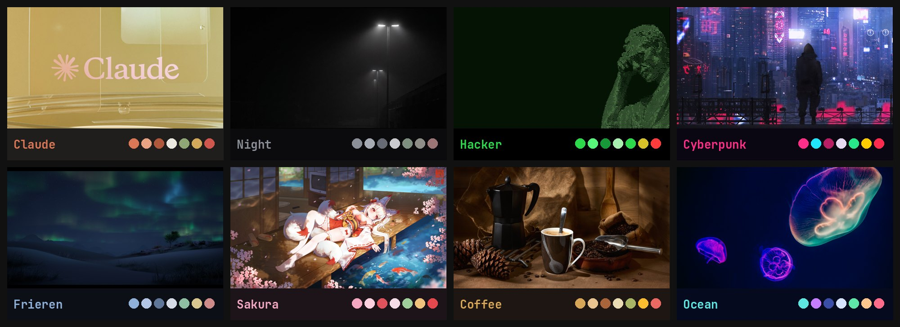

# hypr-rice

[Русский](README.md) · **English**

Hyprland (0.56, Lua config) + Quickshell + Waybar. Eight themes, each with its own palette, fonts,
window animations, lock screen, screenshot animation and shutter sound, waybar battery icon,
volume/brightness OSD and SDDM login screen. Code-OSS, AyuGram, kitty, GTK/Thunar, drift and
neoHtop follow the theme too, and so do the browsers: Firefox, Zen and LibreWolf (colours, font,
rounding, the wallpaper behind the tabs, the theme's emblem as the menu button, a new tab page with
the wallpaper and the theme's name) and Chromium, Brave, Chrome (a theme with the colours, the
wallpaper on the new tab page and the emblem). Browsers pick the theme up on their next start.



## Install

On a fresh Arch (or Arch-based: CachyOS, EndeavourOS, …) system, logged in as your normal user:

```sh
curl -fsSL https://raw.githubusercontent.com/larion928/hypr-rice/main/install.sh | bash
```

The installer asks everything up front and then runs unattended:

1. **sudo password**, once.
2. **Existing rice.** If another desktop is configured (`~/.config/hypr`, `waybar`, `rofi`,
   `dunst`, …) it asks first and moves it to `~/.rice-backup-<date>/`. Nothing is deleted.
3. **Programs.** A checklist (space to tick, enter to go on; nothing is ticked by default):
   browsers (Firefox, Chromium, Brave, Zen, LibreWolf, Vivaldi), AyuGram, Telegram, Discord,
   Steam, Proton for `.exe`, osu!, Prism Launcher, Claude Code, Code-OSS, OBS, LibreOffice, Happ
   and about forty more, see [`packages/apps.txt`](packages/apps.txt).
4. **Install.** Hyprland and everything the rice needs, configs, the SDDM login screen (Hyprland
   preselected), GTK theme, icons, the WhiteCat cursor, services, Fn Lock on Lenovo IdeaPads,
   the claude theme.

Reboot afterwards: the login screen comes up with Hyprland selected.

### Next to another desktop

When another rice or desktop is found (niri, KDE, GNOME, another Hyprland rice, …) the installer asks:

- **Replace.** The old configs move to `~/.rice-backup-<date>/`; Hyprland becomes the default.
- **Side by side.** Nothing of the other desktop is touched; you pick one on the login screen.
  The rice keeps its waybar and kitty configs in `~/.config/hypr-rice/`, its notification daemon
  and portal restarts run only inside Hyprland, and the other desktop keeps its `~/.config/waybar`,
  `kitty`, `mako`, `fish`. Only a foreign Hyprland config is replaced. The GTK theme (Thunar, file
  dialogs) stays shared. You may keep your own login screen; Hyprland shows up in its session list.

### When something is blocked

- **AUR unreachable** (`TLS connect error … unexpected eof`): nothing to do. AUR packages come
  prebuilt and signed from [hypr-rice-pkgs](https://github.com/larion928/hypr-rice-pkgs), which
  GitHub rebuilds weekly; anything missing there is built from the GitHub mirror of the AUR.
- **pacman mirrors stall** (`Operation too slow`): downloads are retried up to 6 times, with
  fallback mirrors from the second retry (the original list is kept as
  `/etc/pacman.d/mirrorlist.rice-backup`).

## The `rice` manager

`rice` stays installed; run it in a terminal or from the launcher (Alt+R → "Менеджер райса"):

| Command | |
|---|---|
| `rice apps` | add programs (the same checklist; installed ones start ticked) |
| `rice remove` | remove programs from the catalog |
| `rice update` | update the rice from GitHub (keeps the theme and machine files) |
| `rice upgrade` | update the system and programs, AUR included |
| `rice proton` | which Proton runs `.exe` files: the latest UMU-Proton (default) or any installed with ProtonPlus |
| `rice repair` | re-apply the SDDM login screen, GTK theme and services |
| `rice report` | write `~/rice-report.txt` for whoever helps you debug |
| `rice uninstall` | remove the rice and restore the last backup |

## Settings (Alt+F2)

Alt+F2, the gear in the bar or the launcher ("Настройки", "Мониторы", "Горячие клавиши") opens:

- **Monitors.** Arrange screens by dragging, resolution, refresh rate, scale, on/off. Applied at
  once and reverted after 15 seconds unless you keep it; saved to `~/.config/hypr/monitors.lua`.
- **Hotkeys.** Change any hotkey (press "Изменить", then the new combo), turn it off, reset it,
  add your own "combo → command", switch the main key Alt ↔ Super. Taken combos are flagged.
  Your changes live in `~/.config/hypr/binds-user.lua`.
- **Theme.** All themes with wallpaper previews.

## System

- **Power.** An icon in the bar (scales, leaf or speedometer): a click cycles power saving (no turbo
  boost, GPU at its lowest), balanced and performance. The launcher has the same entries (`power-mode`).
- **Battery care** (Lenovo IdeaPad): right-click the battery in the bar. Charging stops at about 60%,
  good for a laptop that is always plugged in.
- **Updates.** When there are any, an icon with their number (repos and AUR) shows up in the bar; a
  click runs `rice upgrade`.
- **Package caches** of pacman and yay stay under 200 MB; SSDs get a weekly TRIM.
- **Signed updates.** Every commit of the rice is signed with the author's key. The first install
  remembers that key in `~/.config/hypr-rice/allowed_signers`, and `rice update` (like running the
  installer again) refuses a version from GitHub that is not signed with it.
- **Network.** A click on the network in the bar opens the Wi-Fi picker: networks, the password right
  in the row, the current connection and VPN, forgetting a network. Right-click opens nmtui; a button
  at the bottom opens the full settings.

## Your own settings

`rice update` replaces the rice's files with new versions (the old ones go to `~/.rice-backup-<date>/`).
Keep your changes in these files, updates leave them alone:

| File | |
|---|---|
| `~/.config/hypr/user.lua` | Hyprland: window rules, autostart, env, any Lua. Loaded last, so it can override anything. Apply: `hyprctl reload` |
| `~/.config/hypr/binds-user.lua` | hotkeys (written by the Alt+F2 window) |
| `~/.config/hypr/monitors.lua` | monitors (written by the Alt+F2 window) |
| `~/.config/hypr/devices.lua` | mouse and touchpad (`mouse-sens`) |
| `~/.config/fish/user.fish` | fish: aliases, `PATH`, variables |
| `~/.config/hypr-rice/kitty/user.conf` | kitty: font, opacity, your own keys |
| `~/.config/hypr-rice/waybar/user.css` | bar styles on top of the theme. Apply: `waybar-start` |
| `~/.config/hypr-rice/waybar/config.local.json` | bar modules on top of `config.base.json` |

The same list is in the Alt+F1 cheat sheet.

## Keys

| Keys | |
|---|---|
| Alt + F1 | help with every hotkey |
| Alt + F2 | settings: monitors, hotkeys, theme |
| Alt + Shift + T | theme picker (or `changetheme <name>`) |
| Alt + R | launcher (apps and system commands) |
| Alt + Enter | kitty |
| Alt + B | default browser |
| Alt + E | files (Thunar) |
| Print / Shift + Print | screenshot of an area or window / the whole screen |
| Super + F12 | key passthrough for VMs (QEMU windows and the like turn it on by themselves) |

Themes: `claude`, `night`, `hacker`, `cyberpunk`, `frieren`, `sakura`, `coffee`, `ocean`.

## Installer options

Environment variables before `bash`, e.g. `curl … | RICE_THEME=ocean bash`:

| Variable | |
|---|---|
| `RICE_THEME=ocean` | theme after the install |
| `RICE_APPS=steam,obs,firefox` | programs without the checklist (`all` / `none`) |
| `RICE_ASSUME=y` | answer yes to every question (unattended installs) |
| `RICE_MODE=coexist` | install side by side without asking (`replace` to replace) |
| `RICE_BRANCH=dev` | install from another branch |

## Layout

```
install.sh        bootstrap: fetches the repo and runs `rice install`
rice              the manager (install, programs, update, repair, report)
sync.sh           (author) copy the live rice into the repo, check for secrets, commit, push
packages/         base.txt (repos), aur.txt, apps.txt (program catalog)
home/             goes to ~ ; __HOME__ is replaced with your home path
system/           root helper (folder colours, SDDM), SDDM config, Fn Lock rule, package repo key
```

A theme lives in `home/.config/hypr/themes/<name>/`: `palette.json`, `ui.json`, `hypr.lua`,
`style.css` (waybar), `histui.css`, `hyprlock.conf`, `screenshot.qml`, `shutter.wav`, wallpapers.
Shared app configs are generated from the palette by `~/.config/hypr/scripts/themegen.py`.

## License

Scripts and configs: [GNU GPL v3 or later](LICENSE). The wallpapers, the WhiteCat cursor and the
neoHtop build belong to their authors and are not covered by the GPL; see [THIRD-PARTY.md](THIRD-PARTY.md).
