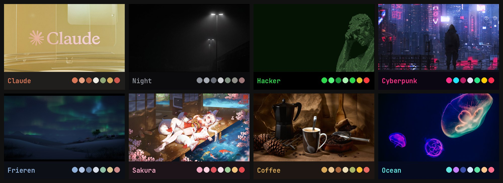

# hypr-rice

**Русский** · [English](README.en.md)

Готовый рабочий стол для Arch Linux: Hyprland 0.57+ (конфиг на Lua), меню и окна на Quickshell, панель
Waybar. Восемь тем и каталог с другими. Тема меняет всё сразу: цвета и шрифты, анимации окон, обои, экран
блокировки и экран входа SDDM, меню, панель, окно громкости, анимацию и звук скриншота, а также
оформление программ.



## Установка

На свежем Arch (или производном: CachyOS, EndeavourOS и т.п.) войди под своим обычным
пользователем и выполни:

```sh
curl -fsSL https://raw.githubusercontent.com/larion928/hypr-rice/main/install.sh | bash
```

Установщик сначала задаёт все вопросы, дальше работает сам:

1. **Пароль sudo.** Один раз в начале.
2. **Старый райс.** Если уже настроено другое окружение (`~/.config/hypr`, `waybar`, `rofi`,
   `dunst`…), спросит разрешения и уберёт его в `~/.rice-backup-<дата>/`. Ничего не удаляется.
3. **Программы.** Список с галочками (пробел: отметить, Enter: дальше), по умолчанию ничего не
   отмечено: браузеры (Firefox, Chromium, Brave, Zen, LibreWolf, Vivaldi), AyuGram, Telegram,
   Discord, Steam, Proton для `.exe`, osu!, Prism Launcher, Claude Code, Code-OSS, OBS,
   LibreOffice, Happ и другие, всего около сотни. Полный список: [`packages/apps.txt`](packages/apps.txt).
4. **Установка.** Hyprland и всё нужное райсу, конфиги, экран входа SDDM (с Hyprland
   по умолчанию), тема GTK, иконки, курсор WhiteCat, сервисы, Fn Lock на Lenovo IdeaPad, тема claude.

После этого перезагрузись: откроется экран входа с выбранным Hyprland.

### Если уже стоит другое окружение

Если найден другой райс или рабочий стол (niri, KDE, GNOME, другой Hyprland…), установщик спросит:

- **Заменить.** Старые настройки уходят в `~/.rice-backup-<дата>/`, по умолчанию будет Hyprland.
- **Поставить рядом.** Чужие настройки не трогаются, выбор окружения на экране входа. Свои
  waybar и kitty райс держит в `~/.config/hypr-rice/`, демон уведомлений и портал запускаются
  только в Hyprland, у другого окружения остаются его `~/.config/waybar`, `kitty`, `mako`, `fish`.
  Заменяется только чужой конфиг Hyprland, если он был (два райса в одном Hyprland не живут).
  Общей остаётся тема GTK (Thunar, окна выбора файлов): её меняют оба окружения.
  Экран входа можно оставить свой: Hyprland появится в его списке сеансов.

### Если что-то заблокировано

- **AUR недоступен** (ошибки вида `TLS connect error … unexpected eof`). Ничего делать не нужно.
  AUR-пакеты берутся готовыми из [hypr-rice-pkgs](https://github.com/larion928/hypr-rice-pkgs):
  их собирает GitHub раз в неделю, они подписаны. Если какого-то пакета там нет, его рецепт
  скачивается с зеркала AUR на GitHub и собирается на месте.
- **Зеркала pacman подвисают** (`Operation too slow`). Установщик повторяет загрузку до 6 раз,
  со второй попытки переключается на запасные зеркала (старый список сохраняется в
  `/etc/pacman.d/mirrorlist.rice-backup`).

## Темы

`claude`, `night`, `hacker`, `cyberpunk`, `frieren`, `sakura`, `coffee`, `ocean`.

Ещё темы, по пакам, в [каталоге](https://github.com/larion928/hypr-rice-themes) (например `mr-robot` в паке
"hacker+"): Alt+F2 → Тема → "Каталог…", `rice themes` или "Темы из каталога" в меню `rice`. Тему из
каталога автор райса прочитал и подписал; она ставится, только если сходятся подпись и контрольная сумма,
и обновляется вместе с `rice update`.

Сменить тему: Alt+Shift+T (карточки тем в их собственных цветах), лаунчер ("Тема …") или
`changetheme <тема>` в терминале. В списках сначала восемь тем райса, за ними свои и из каталога, в том
порядке, в каком они появились.

Под тему подстраиваются программы:

- **Браузеры.** Firefox, Zen и LibreWolf: цвета, шрифт, скругления, обои за вкладками, значок темы
  вместо кнопки меню, новая вкладка с обоями и названием темы. Chromium, Brave и Chrome: тема с
  цветами, обоями на новой вкладке и значком. Браузеры подхватывают тему при следующем запуске.
- **Остальные.** Code-OSS, AyuGram и Telegram, Discord (Vesktop), Obsidian, kitty, GTK и Thunar,
  drift, neoHtop.

Любую тему можно поправить под себя: Alt+F2 → Тема → тема → "Изменить". Там шрифты, цвета
(и цвет папок Papirus), обои, раскладка панели, тема значков и рисунок батареи, курсор, окна
(отступы, рамка, скругление, прозрачность, размытие, скорость анимаций). Сохраняются только отличия
от темы, "Сбросить" возвращает её как была. Темы можно копировать, экспортировать в файл и импортировать.

**Обои.** У темы несколько обоев, их можно добавлять, выключать и удалять. Обои бывают анимированные:
GIF или видео, а также видео-обои из Wallpaper Engine, на которые ты подписан в Steam Workshop (сцены
Wallpaper Engine сами программы, их добавить нельзя). Анимированные обои замирают, пока их целиком
закрывают полноэкранные окна (игра, видео): меньше нагрузка.

## Панель

Модули панели кликабельные:

| Модуль | Клик |
|---|---|
| сеть | панель Wi-Fi: сети, пароль прямо в строке, текущее подключение и VPN, "забыть сеть"; правый клик: nmtui |
| звук | pavucontrol |
| плеер | карточка плеера (см. ниже) |
| телефон | меню телефона (см. ниже); заряд виден, пока сопряжённый телефон на связи |
| режим питания | экономия → баланс → производительность |
| батарея | правый клик: сбережение батареи (Lenovo IdeaPad) |
| обновления | появляется, когда они есть; клик: `rice upgrade` |
| колокольчик | история уведомлений |
| камера | галерея скриншотов |
| шестерёнка, "?", палитра, выключение | настройки, справка, выбор темы, меню выхода |

Раскладка панели меняется перетаскиванием: Alt+F2 → Тема → тема → "Изменить" → Панель. Там же
модули, которых нет на панели по умолчанию (трей, Bluetooth, яркость и другие), значки модулей и
положение панели сверху или снизу. Раскладку можно сохранить для одной темы или для всех.

## Меню

Все меню открываются в цветах и шрифтах текущей темы, повторное нажатие той же клавиши их закрывает,
Esc тоже.

| Меню | Как открыть | Что там |
|---|---|---|
| Лаунчер | Alt+R | программы и команды райса: темы, настройки, сеть, питание, выход; поиск понимает текст, набранный не в той раскладке |
| Настройки | Alt+F2 | мониторы, клавиши, темы, функции, словарь (ниже) |
| Справка | Alt+F1 | все горячие клавиши, собранные из конфига, и файлы своих настроек |
| Выбор темы | Alt+Shift+T | все темы карточками |
| Выход | Alt+M | блокировка, выход, сон, перезагрузка, выключение (опасное только со второго нажатия) |
| Игры | Alt+G | библиотека игр (ниже) |
| Буфер обмена | Alt+Shift+V | последние 100 скопированных записей, поиск; включается в Функциях |
| Уведомления | колокольчик | история по дням, поиск, "не беспокоить" |
| Плеер | модуль "Плеер" на панели | обложка, трек, перемотка, кнопки, громкость, выбор источника, когда играет несколько программ; звук обоев-клипа |
| Звук обоев | модуль "Звук обоев" на панели (Тема → Панель) | карточка обоев-клипа: обложка, звук вкл/выкл, громкость; правый клик включает звук, колесо меняет громкость |
| Скриншоты | камера на панели | все снимки, просмотр, копировать, удалить |
| Телефон | модуль "Телефон" на панели | KDE Connect: заряд, найти телефон, пинг, отправить файлы и буфер обмена, файлы телефона в Thunar, сопряжение; включается в Функциях |

Медиаклавиши управляют тем же плеером, что показан в карточке. Когда программе нужны права
администратора, пароль спрашивает окно в стиле темы. Громкость и яркость показывает окно темы.

## Скриншоты

| Клавиши | |
|---|---|
| Print | область (тянуть) или окно (клик), Enter: весь экран, Esc: отмена |
| Shift+Print | весь монитор сразу |
| Alt+Shift+Print | распознать текст в области (русский и английский), текст копируется в буфер |
| Alt+Shift+C | пипетка: лупа над экраном, клик копирует цвет точки как `#rrggbb` |

Снимок сохраняется в `~/Pictures/screenshots` и копируется в буфер. У каждой темы своя анимация
и звук снимка.

## Настройки (Alt+F2)

Окно настроек открывается по Alt+F2, шестерёнкой в панели или из лаунчера.

- **Мониторы.** Расположение перетаскиванием, разрешение, частота, масштаб, включить/выключить.
  Применяется сразу; если за 15 секунд не нажать "Оставить", всё вернётся как было.
  Сохраняется в `~/.config/hypr/monitors.lua`.
- **Клавиши.** Изменить любую горячую клавишу (нажал "Изменить" → нажал новое сочетание),
  выключить, вернуть, добавить свои "сочетание → команда", сменить главную клавишу Alt ↔ Super.
  Занятые сочетания подсвечиваются. Твои изменения лежат в `~/.config/hypr/binds-user.lua`.
- **Тема.** Все темы, правка темы (см. "Темы"), каталог тем, импорт, копирование, экспорт, сброс, удаление.
- **Функции.** Части райса, которые можно выключить (список ниже). Если функции нужен пакет, окно
  предложит его поставить. Функции ввода и экспериментальные включаются после предупреждения, что они
  могут мешать, и как их выключить. То же из терминала: `rice features`, `rice features on|off <id>`.
- **Словарь** (пока включено исправление опечаток или автоисправление раскладки). Твои слова, которые
  исправление опечаток и автоисправление раскладки знают сверх словаря: добавить (`слово` или
  `слово/образец`, тогда слово склоняется как образец: `горутина/машина`), убрать. Туда же пишет
  Alt+Shift+Enter. Лежат в `~/.config/hypr-rice/words-ru.dic` и `words-en.dic`.

### Функции

В скобках: включена ли функция сразу после установки.

**Анимации**

- **Анимации окон** (вкл). Окна, рабочие столы и меню появляются и исчезают плавно.
- **Анимация скриншота** (вкл). После скриншота играет анимация темы. Без неё экраном можно пользоваться сразу.

**Звук**

- **Звук затвора** (вкл). Щелчок при скриншоте, у каждой темы свой.

**Скриншоты**

- **Распознавание текста** (вкл). Alt+Shift+Print: выдели область, и текст из неё (русский или английский) скопируется в буфер.
- **Пипетка** (вкл). Alt+Shift+C: появляется лупа, клик копирует цвет точки в виде #rrggbb.

**Ввод**

- **Свайп тремя пальцами** (вкл). Три пальца влево или вправо на тачпаде переключают рабочий стол. С прокруткой окон три пальца двигают ленту, а стол переключают четыре.
- **История буфера обмена** (выкл). Alt+Shift+V: последние 100 скопированных записей (до 100 МБ). Если выключить, история удалится.
- **Исправление раскладки** (выкл). Alt+Shift+Пробел перепечатывает последнее слово в другой раскладке, повторное нажатие возвращает как было. Alt+Ctrl+Пробел делает то же с выделенным текстом. Нажатия никуда не записываются, в памяти только текущее слово. Нужна группа `input`, окно предложит добавить.
- **Автоисправление раскладки** (выкл). Если слово набрано не в той раскладке, после пробела оно исправится само. Отменить: Alt+Shift+Пробел. В окнах на весь экран не срабатывает. Работает только вместе с исправлением раскладки. Программы, где оно не нужно: `exclude` в `~/.config/hypr-rice/layout-fix.json`.
- **Исправление опечаток** (выкл, экспериментальная). Alt+Shift+Пробел на слове с опечаткой: первое нажатие меняет раскладку, следующие перебирают подсказки, после последней возвращается набранное. Первыми идут слова, которые ты печатаешь чаще: для этого считается, какие слова из словаря ты набираешь (в ~/.config/hypr-rice; пароль попадёт туда, только если это обычное слово). Alt+Shift+Enter добавляет последнее слово в твои слова, а незнакомое слово, оставленное после перебора, добавляется само. Список на вкладке Словарь. Работает только вместе с исправлением раскладки. Счётчики слов лежат в `~/.config/hypr-rice/words-ru-used.json` и `words-en-used.json`, твои слова в `words-ru.dic` и `words-en.dic`.

**Окна**

- **Прокрутка окон** (выкл, экспериментальная). Окна выстраиваются колонками в бесконечную ленту, как в niri. Alt+P меняет ширину колонки, Alt+Shift+P умещает видимые колонки на экран.

**Внешний вид**

- **Размытие под меню** (вкл). Фон под лаунчером, уведомлениями и другими меню размыт. Без размытия меньше нагрузка на видеокарту.

**Обои**

- **Пауза анимированных обоев** (вкл). Обои замирают, когда их целиком закрывает окно на весь экран. Меньше нагрузка в играх и при просмотре видео.
- **Звук обоев** (выкл). Обои-клип играют со своим звуком. Звук плавно затихает, когда обои закрыты окном на весь экран, играет другой плеер или экран заблокирован. Громкость в плеере на панели.
- **Цвет в такт клипу** (вкл). Если тема умеет (Средневековье), меню, панель и рамки окон сереют вместе с обоями-клипом и снова становятся цветными, когда цветным становится клип.

**Система**

- **Ежедневная проверка системы** (вкл). Раз в день проверяет систему (rice doctor) и присылает уведомление, если что-то нашла.

**Устройства**

- **Автомонтирование USB-дисков** (вкл). Флешки и карты памяти подключаются сами. Пока диск вставлен, на панели виден его значок (Тема → Панель → Трей). Извлечь можно через значок или в Thunar.
- **Уведомления о дисках** (выкл). Уведомление, когда диск подключён (с кнопкой "Открыть") и когда отключён. Работает только вместе с автомонтированием.
- **Телефон (KDE Connect)** (выкл). Заряд телефона на панели (Тема → Панель → Телефон), по клику меню: найти телефон, отправить файлы и буфер обмена, открыть файлы телефона. В Thunar появится пункт "Отправить через KDE Connect". Если ufw закрывает порты 1714-1764, окно предложит их открыть.

## Игры

- **Библиотека** (Alt+G): игры карточками с обложками, поиск, запуск по Enter. Добавить можно `.exe`
  (запускается через Proton), AppImage, любой файл программы, установленную программу или игру из
  Steam. Библиотека лежит в `~/.config/hypr-rice/games.json`, обновления райса её не трогают.
- **`.exe` двойным кликом.** Windows-программы (`.exe`, `.msi`, `.bat`, `.lnk`) открываются через
  Proton. Версия Proton: `rice proton` (по умолчанию последняя UMU-Proton).
- **Оптимизация:** `rice games`, каждая включается отдельно. GameMode (приоритет процессора и диска
  на время игры), NTSync, тиринг для полноэкранных игр, ядро linux-zen.

## Устройства

- **Мышь.** `mouse-sens`: чувствительность вживую. `rice mouse-test`: ведёшь мышь вдоль линейки с
  зажатой левой кнопкой, тест измеряет угол датчика (и предлагает поворот, который его исправит),
  разрешение и частоту опроса. Настройки лежат в `~/.config/hypr/devices.lua`.
- **Флешки и карты памяти** подключаются сами (функция "Автомонтирование").
- **Lenovo IdeaPad:** Fn Lock, сбережение батареи (зарядка до ~60%, правый клик по батарее).

## Система

- **Питание.** Экономия (без турбобуста, видеокарта на минимуме), баланс и производительность:
  модуль на панели или лаунчер (`power-mode`).
- **Обновления.** Значок на панели с числом обновлений (репозитории и AUR), клик запускает `rice upgrade`.
- **Проверка системы.** `rice doctor` ищет, что сломано, объясняет почему и что делать; `--fix`
  предлагает лечение. Раз в день проверка идёт сама и присылает уведомление, если что-то нашла.
- **Кэш пакетов** pacman и yay не растёт больше 200 МБ, SSD раз в неделю получает TRIM.
- **Подписанные обновления.** Каждый коммит райса подписан ключом автора. При первой установке ключ
  запоминается в `~/.config/hypr-rice/allowed_signers`, и `rice update` (как и повторный запуск
  установщика) не применит версию с GitHub, подписанную не им.

## Менеджер `rice`

После установки в системе остаётся команда `rice`. Её меню открывается в терминале или из
лаунчера ("Менеджер райса"):

| Команда | Что делает |
|---|---|
| `rice apps` | доставить программы: тот же список, установленные уже отмечены |
| `rice remove` | удалить программы из списка |
| `rice themes` | темы из каталога: отмеченные стоят, `rice themes install\|remove <тема или пак>` |
| `rice update` | обновить райс с GitHub: его файлы и недостающие пакеты (тема и настройки этой машины сохраняются, систему не обновляет) |
| `rice upgrade` | обновить систему и программы, включая AUR |
| `rice features` | функции райса: список, `rice features on\|off <id>` |
| `rice games` | игровые оптимизации: GameMode, NTSync, тиринг, linux-zen |
| `rice proton` | какая версия Proton запускает `.exe`: последняя UMU-Proton (по умолчанию) или любая из ProtonPlus |
| `rice doctor` | проверить систему и райс; `--fix`: лечить, `--full`: ещё и медленные проверки |
| `rice repair` | починить: экран входа SDDM, тема GTK, сервисы, функции |
| `rice mouse-test` | угол датчика мыши (и поворот, который его исправит), разрешение, частота опроса |
| `rice report` | собрать отчёт `~/rice-report.txt`, чтобы прислать тому, кто помогает |
| `rice uninstall` | убрать райс и вернуть настройки, которые были до него |

## Свои настройки

`rice update` заменяет файлы райса новыми версиями без бэкапа: бэкап делается только при первой установке.
Свои правки держи в этих файлах, обновление их не трогает:

| Файл | Что там |
|---|---|
| `~/.config/hypr/user.lua` | Hyprland: правила окон, автозапуск, переменные, любой Lua. Грузится последним, поэтому может переопределить что угодно. Применить: `hyprctl reload` |
| `~/.config/hypr/binds-user.lua` | горячие клавиши (пишет окно Alt+F2) |
| `~/.config/hypr/monitors.lua` | мониторы (пишет окно Alt+F2) |
| `~/.config/hypr/devices.lua` | мышь и тачпад (`mouse-sens`, `rice mouse-test`) |
| `~/.config/hypr-rice/theme-edits.json` | правки тем (пишет окно Alt+F2) |
| `~/.config/hypr-rice/features.json` | какие функции включены (пишет окно Alt+F2 и `rice features`) |
| `~/.config/hypr-rice/words-ru.dic`, `words-en.dic` | твои слова для исправления опечаток (пишет окно Alt+F2 и Alt+Shift+Enter) |
| `~/.config/hypr-rice/games.json` | библиотека игр (пишет окно Alt+G) |
| `~/.config/fish/user.fish` | fish: алиасы, `PATH`, переменные |
| `~/.config/hypr-rice/kitty/user.conf` | kitty: шрифт, прозрачность, свои клавиши |
| `~/.config/hypr-rice/waybar/user.css` | стили панели поверх темы. Применить: `waybar-start` |
| `~/.config/hypr-rice/waybar/config.local.json` | модули панели поверх `config.base.json` |

Этот же список есть в справке Alt+F1.

## Горячие клавиши

Главная клавиша Alt, в настройках её можно сменить на Super. Полный список: Alt+F1.

| Клавиши | |
|---|---|
| Alt+R | лаунчер |
| Alt+Enter | терминал kitty |
| Alt+B | браузер по умолчанию |
| Alt+E | файлы (Thunar) |
| Alt+G | игры |
| Alt+F1 / Alt+F2 | справка / настройки |
| Alt+Shift+T | выбор темы |
| Alt+Shift+V | история буфера обмена |
| Alt+M | меню выхода |
| Alt+I | заблокировать экран |
| Alt+C | закрыть окно |
| Alt+V | окно плавающее / в сетке |
| Alt+стрелки | фокус на соседнее окно |
| Alt+Shift+H/J/K/L | поменять окно местами с соседним |
| Alt+H/J/K/L | изменить размер окна |
| Alt+1…0 / Alt+Shift+1…0 | перейти на рабочий стол / отправить туда окно |
| Alt+S / Alt+Shift+S | скрытый рабочий стол / отправить туда окно |
| Alt+Tab | предыдущий рабочий стол |
| Print, Shift+Print, Alt+Shift+Print, Alt+Shift+C | скриншоты, текст, пипетка (см. "Скриншоты") |
| Alt+Shift+O | перезапустить панель |
| Alt+Shift+Пробел / Alt+Ctrl+Пробел | последнее слово / выделенный текст в другой раскладке (функция "Исправление раскладки"); с "Исправлением опечаток": подсказки словаря для слова с опечаткой |
| Alt+Shift+Enter | запомнить последнее слово в своём словаре (с "Исправлением опечаток" или "Автоисправлением раскладки") |
| Super+F12 | сквозной режим клавиш для виртуалок (окна QEMU и др. включают его сами) |

## Настройки установщика

Переменные окружения перед `bash`, например `curl … | RICE_THEME=ocean bash`:

| Переменная | |
|---|---|
| `RICE_THEME=ocean` | тема после установки |
| `RICE_APPS=steam,obs,firefox` | программы без окна выбора (`all`: все, `none`: никаких) |
| `RICE_ASSUME=y` | ответить "да" на все вопросы (для автоматической установки) |
| `RICE_MODE=coexist` | поставить рядом с другим окружением, не спрашивая (`replace`: заменить) |
| `RICE_BRANCH=dev` | ставить из другой ветки |

## Устройство репозитория

```
install.sh        загрузчик: скачивает репозиторий и запускает rice install
rice              менеджер райса; его части в lib/
doctor/           rice doctor: проверки системы и райса и их лечение
sync.sh           (для автора) собрать райс в репозиторий и отправить в dev; --release выпускает в main
packages/         base.txt (репозитории), aur.txt, apps.txt (каталог программ)
home/             раскладывается в ~ ; __HOME__ заменяется на твою домашнюю папку
system/           root-помощник (цвет папок, SDDM, питание), конфиг SDDM, Fn Lock, ключ репозитория пакетов
tests/            run.sh: тесты менеджера и скриптов; python/: тесты скриптов на Python;
                  qml/: меню Quickshell вне экрана (что они делают: qml/BEHAVIOUR.md)
```

Тесты систему не меняют: у каждого пустой поддельный `$HOME`, pacman и sudo заменены заглушками.

Тема лежит в `home/.config/hypr/themes/<имя>/`: `palette.json`, `ui.json`, `hypr.lua`,
`style.css` (waybar), `histui.css`, `hyprlock.conf`, `screenshot.qml`, `battery.py` (значок батареи),
`shutter.wav` и обои. Конфиги программ генерируются из палитры скриптом
`~/.config/hypr/scripts/themegen.py`; код для каждой программы лежит в `scripts/apptheme/`.
Меню лежат в `home/.config/quickshell/shell/`, одна оболочка Quickshell на все меню.

## Лицензия

Скрипты и конфиги: [GNU GPL v3 или новее](LICENSE). Обои, курсор WhiteCat и собранный neoHtop
принадлежат своим авторам и под GPL не попадают, список с источниками в [THIRD-PARTY.md](THIRD-PARTY.md).
